# GARBLE: architecture

Status: draft 2 (independent review applied), 2026-10-04. Inputs: `docs/research.md` (the evidence base, cited as R§n), an OpenMLS API check, and a read of Meridian's `marking.rs` and Merkle code. No implementation code exists yet. The Rust signatures below are design contracts, not code.

**One-line thesis.** Signal-grade confidentiality with the opposite accountability: every message is signed, attributable, logged and retained, and need-to-know is enforced cryptographically by every client, not only by the server.

---

## 1. System context

### 1.1 Actors

| Actor | Role | Sees plaintext? |
|---|---|---|
| **User** | Enrolls once with CAC/PIV; sends marked messages and files | Rooms they're in |
| **Room steward** | Owns a room: ceiling, discovery card, access approvals, membership | That room |
| **Records custodian** | Service member of every room; archives (DoDI 8170.01) | Every room |
| **DS operator / sysadmin** | Runs DS, log, blob store | **No** (the thesis) |
| **Attribute authority** | Signs hours-long clearance credentials from personnel-security data | No |
| **Enrollment authority (EA)** | Verifies the CAC attestation; issues the identity credential | No |
| **ISSM / insider-threat investigator** | Runs a witness, reviews the log, requests custodian exports | Via export only |

### 1.2 Components and trust boundaries

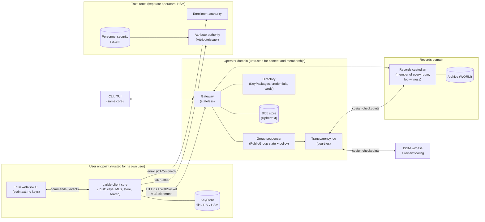

Each boxed domain is a trust boundary. What each one is trusted for is in §2.3. The **authorization boundary** for RMF is clients + DS (gateway, sequencer, directory, blob store) + log + custodian (R§2, 800-37). The EA and attribute authority sit at the boundary and may be inherited enterprise services.

**One deployment per security fabric.** A SIPRNet GARBLE and a JWICS GARBLE share no keys, logs, or directories. Nothing in the design crosses domains.

---

## 2. Threat model

### 2.1 Defended against

| Adversary | Capability assumed | What GARBLE guarantees | Mechanism |
|---|---|---|---|
| **Malicious sysadmin** | Root on every DS, log and blob host. Can read disks, alter code, inject traffic | Cannot read message or file content. Cannot add anyone to a room. Cannot rewrite history without detection | MLS E2EE; client-side `policy::decide` on every Commit; clients reject external commits; witnessed log |
| **Compromised DS** (software) | Same as above, remotely | Same as above | Same |
| **Over-cleared insider** | A legitimate member of a room who misuses access | Every action is attributable and logged. Screenshots and photos trace back to the viewer. Access requests to other rooms are logged even when refused | Mandatory signatures (no deniability); per-message log entries; identity watermark; DS read-cursor audit |
| **Departing / debriefed user** | Keeps their device; wants future content | Removed within one credential lifetime + `removal_grace` (§5.7). No content from any epoch after removal. Before removal, only the DS withholds delivery. Local history is purged on honest clients | Attribute expiry → MLS Remove → new epoch; purge-and-report |
| **Uncleared joiner (Signalgate)** | A steward mistakenly adds the wrong person | The add is refused by the steward's own client, by the DS, and by every other member's client. The refusal is logged | `dominates(clearance, ceiling)` in all three places |

### 2.2 Explicitly not defended against

| Threat | Why not | Who owns it |
|---|---|---|
| **Compromised endpoint** (malware, a malicious build on the user's machine) | It has the user's keys and plaintext. Purge, watermark and composer rules are all client-enforced | Endpoint security, HBSS, STIG baseline, software signing (SI-7) |
| **The fabric itself** (link interception, TEMPEST) | GARBLE is defense in depth on an already-encrypted network, not a Type 1 product | Type 1 link encryptors (CNSSP 15) |
| **Malicious trust roots** (EA or attribute authority) | Whoever signs clearances decides who is cleared | Personnel security; HSM custody; separation of duties |
| **Metadata from the operator** | The DS sees room membership, sender, timing, size and each message's marking (§4.5). For a government system this is accountability, not a leak (R§3, §16.4) | Accepted; the DS and its log are classified at the fabric level |
| **Denial of service by the operator** | A DS can always drop or delay (RFC 9420 §16.9) | Detected (log gaps, sequence gaps); not prevented |
| **A malicious member exfiltrating what they legitimately see** | Can't be prevented; only made attributable | Watermark, logging, insider-threat program |

### 2.3 What each component is trusted for

| Component | Trusted for | Not trusted for | Required deployment control |
|---|---|---|---|
| Client core | Its user's keys, plaintext, policy enforcement | Anything about other users beyond verified signatures | Signed builds, STIG'd endpoint |
| Tauri webview | Rendering | Keys, policy decisions | Strict CSP, no remote content |
| DS gateway / sequencer | Ordering, delivery, availability, fast-path policy rejects | Confidentiality, membership integrity, log honesty | None beyond normal ops; the design assumes it may be hostile |
| Transparency log | Nothing alone | Anything unwitnessed | ≥ 2 independent witnesses |
| Witnesses (custodian, ISSM tool) | Refusing to cosign inconsistent checkpoints | Content | Operated outside the DS admin group |
| Attribute authority / EA | Truth of clearances and identity bindings | n/a (root) | HSM keys; operators ≠ DS admins |
| Records custodian | Complete, faithful archive | n/a (holds plaintext) | HSM keys; two-person archive export |

---

## 3. Crate layout

Ten crates. Two are pure, two are wire and identity, two are infrastructure libraries, and four are binaries. A new engineer should be able to hold this table in their head.

| Crate | Kind | Responsibility | Key public surface |
|---|---|---|---|
| `markings` | lib, **pure** | Parse, render, compare and aggregate CAPCO markings. `Clearance` and dominance. Register data types | `Marking`, `Clearance`, `Registers`, `parse`, `dominates`, `Marking::within`, `aggregate`, `canonical_bytes` |
| `policy` | lib, **pure** | The only place access decisions are made | `decide(&Subject, &Resource, &Action) -> Decision`, `RoomPolicy`, `DenyReason`, `POLICY_VERSION` |
| `proto` | lib | Every byte on the wire or in the log: envelopes, extensions, cards, credentials, DS API, log entries. Versioned `tls_codec` encoding. The ciphersuite constant | `CIPHERSUITE`, `WireVersion`, `Envelope`, `RoomPolicyExt`, `DiscoveryCard`, `LogEntry`, `api::*` |
| `identity` | lib | Enrollment attestation, credential issuing and verification, trust bundle. Turns signed bytes into a verified `policy::Subject` | `trait KeyStore`, `trait AttributeIssuer`, `MockIssuer`, `TrustBundle`, `verify_subject` |
| `tlog` | lib | RFC 6962 tree, tlog-tiles layout, signed-note checkpoints, cosignature verification, inclusion and consistency proofs | `Log<S: TileStore>`, `Checkpoint`, `Cosignature`, `verify_inclusion`, `verify_consistency` |
| `client` | lib | Everything a client does: OpenMLS groups, sync, local encrypted store, search, file crypto, purge, banner computation | `Client`, `ClientEvent`, `RoomView`, `trait Transport` |
| `ds` | bin + lib | Delivery service: gateway, sequencer, directory, blob front, log appender. Role flags pick which parts a process runs | `trait GroupStore`, `trait BlobStore`, `Sequencer`, `--role` |
| `custodian` | bin | Records custodian member and log witness | (binary) |
| `garble-cli` | bin | CLI and TUI: proof-of-concept, admin, scripting | (binary) |
| `garble-desktop` | bin | Tauri app; the Rust side is a thin command adapter over `client` | Tauri commands and events (§7.1) |

Plus `xtask` (not shipped): OSCAL generation, register-bundle signing, and release tasks.

**Not a crate:** the crypto provider. GARBLE uses OpenMLS's own `OpenMlsProvider` trait: libcrux by default, and a validated provider under the `fips` feature (§11). A wrapper trait over it would have no second implementation.

### 3.1 Dependency direction

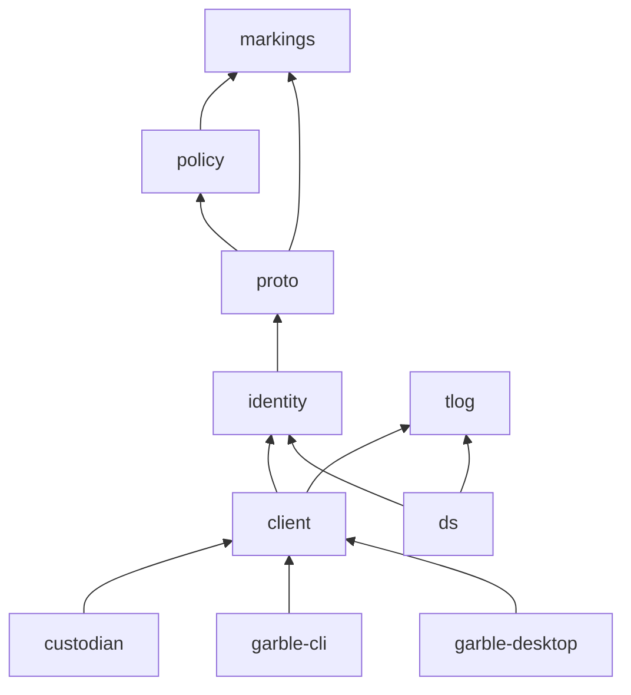

Rules enforced in CI with `cargo deny` bans and a workspace lint:

- `markings` and `policy` depend on nothing but `serde`/`std`. **No I/O, no clock, no randomness, no crypto.** Time enters as a value.
- `tlog` knows nothing about GARBLE messages. It hashes opaque leaves and signs through a `Signer`.
- Only `client`, `ds` and `identity` depend on `openmls`.
- No crate depends on a binary crate.

### 3.2 Seams (traits a real deployment swaps)

| Seam | Trait | v1 implementation | Production implementations |
|---|---|---|---|
| Signing-key storage | `identity::KeyStore` | Encrypted file (key wrapped by OS keychain) | PKCS#11 HSM; PIV (once SP 800-78-6 cards exist) |
| Attribute issuer | `identity::AttributeIssuer` | `MockIssuer` (YAML of users and clearances) | Site service fed by DISS / Scattered Castles |
| Crypto provider | `openmls_traits::OpenMlsProvider` | libcrux | `fips` feature: validated module |
| DS state | `ds::GroupStore` | SQLite | PostgreSQL (partitioned) |
| Blobs | `ds::BlobStore` | Local filesystem | S3-compatible object store |
| Log tiles | `tlog::TileStore` | Local filesystem | Same object store |
| Client transport | `client::Transport` | HTTPS + WebSocket | In-memory (tests) |

```rust
pub trait KeyStore: Send + Sync {
    fn generate(&self, label: &KeyLabel) -> Result<PublicKey, KeyError>;   // ML-DSA-87
    fn signer(&self, label: &KeyLabel) -> Result<Box<dyn openmls_traits::signatures::Signer>, KeyError>;
    fn destroy(&self, label: &KeyLabel) -> Result<(), KeyError>;
}

pub trait AttributeIssuer: Send + Sync {
    /// Issue a fresh attribute credential for `subject`, valid for hours.
    /// Fails closed: an unknown subject is an error, never an empty clearance.
    fn issue(&self, subject: &UserId, proof: &IssuanceProof) -> Result<AttributeCredential, IssueError>;
    fn issuer_keys(&self) -> Vec<IssuerKey>;
}
```

---

## 4. Data model

All wire and log structures are encoded with the TLS presentation language (`tls_codec`), the same encoding MLS uses. Every top-level structure starts with a `u16` version. Unknown versions are rejected; there is no "best effort" decoding.

### 4.1 Markings (`markings`)

Adapted from Meridian's `marking.rs` (copied, not depended on). See §4.1.1 for what changes.

```rust
pub enum Level { Unclassified, Confidential, Secret, TopSecret }          // CUI is NOT here

pub struct Marking {
    pub level: Level,
    pub sci: BTreeSet<SciControl>,       // control system + structured sub-compartments
    pub sap: BTreeSet<SapProgram>,       // parses; policy refuses SAP rooms in v1
    pub aea: BTreeSet<AeaMarking>,       // RD, FRD, CNWDI
    pub fgi: Option<Fgi>,
    pub dissem: BTreeSet<Dissem>,        // NOFORN, ORCON, RSEN, FISA, ... (strict: no Other)
    pub rel_to: Option<RelTo>,           // sorted, deduped ISO 3166 alpha-3 on parse
    pub cui: Option<CuiBlock>,           // orthogonal to level: categories + LDC
}

pub struct Clearance {
    pub level: Level,
    pub sci: BTreeSet<SciControl>,
    pub sap: BTreeSet<SapProgram>,
    pub aea: BTreeSet<AeaMarking>,
    pub citizenship: Country,            // drives NOFORN and REL TO
    pub dissem_grants: BTreeSet<Dissem>, // explicit grants for ORCON, RSEN, FGI handling; default deny
    pub cui: BTreeSet<CuiCategory>,
}

pub fn parse(s: &str, reg: &Registers) -> Result<Marking, MarkingError>;   // strict only
pub fn dominates(c: &Clearance, m: &Marking) -> Result<(), Shortfall>;   // Shortfall lists every gap
impl Marking {
    pub fn within(&self, ceiling: &Marking) -> bool;   // partial order: may self be held under ceiling?
    pub fn max(&self, other: &Marking) -> Result<Marking, MarkingError>;  // high-water mark
    pub fn portion(&self) -> String;                   // "TS//SI//NF"
    pub fn banner(&self) -> String;                    // "TOP SECRET//SI//NOFORN"
    pub fn canonical_bytes(&self) -> Result<Vec<u8>, MarkingError>;  // leading format byte = 1
    pub fn from_canonical(b: &[u8], reg: &Registers) -> Result<Marking, MarkingError>;
}
pub fn aggregate<'a>(ms: impl IntoIterator<Item = &'a Marking>) -> Result<Marking, MarkingError>;
```

`Registers` (SCI register, country list, CUI categories) are loaded at runtime from the signed **trust bundle** (§4.3). There is no compiled-in default outside a `sample-registers` feature used only by tests and the demo. If no register is loaded, `parse` returns `MarkingError::NoRegister`. That is fail closed.

#### 4.1.1 Meridian reuse

**Copy:** the token grammar (`marking.rs:728–846`), slot-order check (`:559–570`), rendering (`:418–469`), `reconcile_releasability` (`:644–685`), and the tests. **Change:** the six locked changes, plus these fail-open behaviors:

| # | Meridian behavior | Why it's wrong for access control | GARBLE change |
|---|---|---|---|
| 1 | `parse("")` returns `Marking::default()`, i.e. UNCLASSIFIED (`:547–549`) | An empty marking field becomes U. The composer could send an unmarked message as U | Strict mode: empty input → `MarkingError::Empty` |
| 2 | With no register passed, the parser falls back to the compiled-in sample register (`:553–556`) | A production node could silently run on sample data | No fallback; `Registers` is a required argument |
| 3 | `SciRegister::allows` returns `true` for an empty designator and for every kind except SCI and SAP (`:288–303`) | FGI, RD and CNWDI designators go unchecked | Validate FGI country codes against the country register; reject unknown AEA forms |
| 4 | `is_other_caveat` accepts any alphabetic token as `Caveat::Other` (`:171–191`, `:839`) | Fail open (already noted in research) | Strict: an error. Grow the typed `Dissem` set from the ISM CVE list instead (PROPIN, IMCON, DSEN, EXDIS, NODIS, LIMDIS, and others are missing today) |
| 5 | `Marking` derives `PartialEq`/`Hash` over `Vec`s (`:333–340`), while `canonical_bytes` sorts | Not only REL TO: *any* caveat or compartment order makes two equal markings compare unequal | `BTreeSet` fields, so equality, hashing and encoding agree by construction |
| 6 | `Level` includes `Cui` between U and C, and the encoding uses `level as u8` (`:22–33`, `:346`) | Removing `Cui` silently renumbers the encoding | `CuiBlock` is separate; explicit discriminants; format byte 1 |
| 7 | SCI sub-compartments are opaque strings (`SI-G ABCD` must be in the register verbatim) | `dominates` needs "does access to SI-G imply SI?" | `SciControl { system, compartments: BTreeSet<SciCompartment { name, subs }> }` |
| 8 | REL TO roll-up keeps `REL TO USA,GBR` when the other marking has *no* foreign-disclosure control (`:652–668`) | Probably fail open: an unmarked classified portion is not releasable, so the banner should not claim REL TO **(verify against the CAPCO register)** | Treat a missing FD control on a classified portion as NOFORN during aggregation, pending verification |
| 9 | `Result<_, String>` everywhere; one `crate::error::Error` use (`:274–282`) | Already noted in research | `MarkingError` enum with stable codes |

**Drop:** `from_stored` (lenient legacy parsing), the `bundled()` registers and `include_str!` paths, `warnings()`, and `FromStr`.

**Merkle (`merkle.rs`):** RFC 6962-compatible hashing (0x00/0x01 domain separation; bottom-up promotion gives the same root as RFC 6962's split). But it has inclusion proofs only: no consistency proofs, no checkpoints, all leaves in memory, and hex proofs with `is_left` flags. Meridian signs with ML-DSA-65, not 87. *For `tlog`:* copy `leaf_hash`/`node_hash` and the tests, keep `root()` as a test oracle, and write the RFC 9162 tile-addressed inclusion and consistency proofs (tested against the Go `sumdb/tlog` vectors) and the ML-DSA-87 signed-note checkpoints.

### 4.2 Credentials (`identity`, encoded in `proto`)

Two credentials, with very different lifetimes.

| | `IdentityCredential` | `AttributeCredential` |
|---|---|---|
| Binds | user ID + device ID → ML-DSA-87 public key | user ID → `Clearance` |
| Issuer | Enrollment authority (ML-DSA-87 key in HSM) | Attribute authority via `AttributeIssuer` (ML-DSA-87) |
| Lifetime | Months (site parameter, default 1 year) | **Hours** (site parameter, default 8 h; refresh at 50%) |
| Evidence | Hash of the CAC-signed `EnrollmentAttestation` and of the CAC certificate | Issuer serial |
| Where it lives | Inside the MLS `LeafNode` as a GARBLE custom credential type | In the DS directory; referenced by hash from every message; embedded as evidence in Add commits |
| Revocation | Expiry plus EA deny-list in the trust bundle | **Expiry only** (locked decision) |

```rust
pub struct IdentityCredential {
    pub version: u16,
    pub user: UserId,                 // stable, from the CAC subject (EDIPI-derived)
    pub device: DeviceId,
    pub display_name: String,
    pub signature_key: MlDsa87PublicKey,
    pub attestation_hash: [u8; 48],   // SHA-384 of the CAC-signed EnrollmentAttestation
    pub not_before: Timestamp,
    pub not_after: Timestamp,
    pub ea_key_id: KeyId,
    pub ea_signature: MlDsa87Signature,
}

pub struct AttributeCredential {
    pub version: u16,
    pub serial: [u8; 16],
    pub user: UserId,
    pub clearance: Clearance,         // canonical bytes, register version pinned
    pub register_version: u32,
    pub not_before: Timestamp,
    pub not_after: Timestamp,         // hours after not_before
    pub issuer_key_id: KeyId,
    pub signature: MlDsa87Signature,
}
pub type CredentialRef = [u8; 48];    // SHA-384 of the encoded AttributeCredential
```

**Why attributes aren't in the ratchet tree.** Leaf credentials would force an Update and Commit per room, per user, every few hours. For an ops-center user in 50 rooms, that's 150 commits a day. Instead, credentials are DS-unforgeable signed objects in the directory. Messages reference their sender's by hash, Adds embed the joiner's, and verifiers cache them. A DS that withholds one only causes a fail-closed deny.

### 4.3 Trust bundle

One signed file per deployment, signed by the ISSM's offline key. Every client, DS node and custodian loads it at start and refuses to run without it. The ISSM root public key is pinned in the signed build at install time, so the DS can't substitute a bundle.

| Field | Purpose |
|---|---|
| `deployment_id`, `fabric` | `"jwics-prod-1"`, `TS`; the fabric ceiling. No room may exceed it |
| EA keys, attribute-issuer keys | Trust roots |
| DS external-sender key | Allowed to send Remove proposals (§5.7) |
| Log public key, witness keys, quorum `k` | Checkpoint acceptance |
| Custodian identity | The one custodian user ID (v1; see §12.2) |
| Registers + `register_version` | SCI register, countries, CUI categories |
| Site parameters | Credential lifetime, `removal_grace`, clock skew, retention, banner text, max room size (OSCAL `set-parameters`) |
| `min_policy_version` | Oldest `policy` crate version allowed to participate |

### 4.4 Room policy (MLS GroupContext extension)

`RoomPolicyExt` is a GroupContext extension in the private-use range, listed in `required_capabilities` so that no client that doesn't understand it can join. Changing it requires a `GroupContextExtensions` proposal, which goes through `policy::decide` like everything else.

```rust
pub struct RoomPolicyExt {
    pub version: u16,
    pub room_id: RoomId,                 // == MLS group_id
    pub policy_version: u32,             // policy crate semantics this room was created under
    pub ceiling: Marking,                // every message must be `within` this
    pub stewards: Vec<UserId>,           // may Add, Remove others, change policy
    pub custodian: UserId,               // must be in the tree; cannot be removed
    pub card: Option<CardPolicy>,        // discovery card marking + whether published
    pub flags: RoomFlags,                // files_allowed, max_members
}
```

Alongside it, the group carries the standard `external_senders` extension containing the DS key. That lets the DS propose (never commit) Removes.

#### 4.4.1 The `policy` surface

```rust
pub const POLICY_VERSION: u32 = 1;

pub struct Subject {                       // built by the shell from *verified* credentials
    pub user: UserId,
    pub device: DeviceId,
    pub clearance: Clearance,
    pub attrs_valid: (Timestamp, Timestamp),
    pub as_of: Timestamp,                  // the decision time, see below
    pub role: Role,                        // Member | Steward | Custodian | DeliveryService | NonMember
}
pub enum Resource<'a> {
    Room { policy: &'a RoomPolicy, members: &'a [MemberInfo], fabric: &'a Marking },
    Card { card: &'a DiscoveryCard, room_ceiling: &'a Marking },
}
pub enum Action<'a> {
    Create,
    Commit { proposals: &'a [ProposalView], evidence: &'a [Subject] },  // one decision per Commit
    Send { marking: &'a Marking, files: &'a [Marking] },
    PublishCard, ViewCard, RequestAccess,
}
pub enum Decision { Permit, Deny(DenyReason) }
#[non_exhaustive]
pub enum DenyReason {                      // each has a stable code, e.g. "P-003", shown in the UI and logged
    ClearanceShortfall { user: UserId, shortfall: Shortfall },
    AttributesExpired { user: UserId, at: Timestamp },
    AboveCeiling { marking: Marking, ceiling: Marking },
    AboveFabric, SapRoomsUnsupported, NotSteward, CustodianRequired,
    ProposalTypeForbidden(u16), ExternalCommitForbidden, RemoveWithoutEvidence, PartialUserRemove,
    UnknownMarking(MarkingError), PolicyVersionTooNew(u32),
}
pub fn decide(subject: &Subject, resource: &Resource, action: &Action) -> Decision;
```

**Decision time.** `as_of` is `HandshakeAad.decided_at` (or `AppAad.sent_at`), which the sender signs. The DS rejects it if it is more than the skew window from its own clock, and clients reject it if it is more than the skew window from the DS sequence time. Every party therefore decides on the same inputs and the same `as_of`, so honest verifiers can't disagree because of clock drift.

#### 4.4.2 Invariants `policy` checks on every Commit

Dominance is checked **only for what the commit changes**: joiners, and the whole roster when the ceiling is raised. A member whose credential has lapsed doesn't block unrelated commits, including the Remove that evicts them.

| Invariant | DenyReason |
|---|---|
| Allowed proposal types: Add, Remove, Update, GroupContextExtensions, and ReInit only to the configured ciphersuite. Everything else (PSK, ExternalInit, custom) is denied | `ProposalTypeForbidden` |
| Each joiner's clearance, valid at `as_of`, `dominates` the ceiling | `ClearanceShortfall`, `AttributesExpired` |
| Raising the ceiling: every member post-commit dominates the new one | `ClearanceShortfall` |
| Ceiling `within` the fabric ceiling; no SAP compartments in v1 | `AboveFabric`, `SapRoomsUnsupported` |
| The custodian is in the post-commit tree | `CustodianRequired` |
| Stewards Add others, Remove others, and change policy. Anyone may remove themselves. A user's existing device may Add that user's **new device** (`AddOwnDevice`), still subject to dominance | `NotSteward` |
| Any member may commit a DS external Remove proposal, but only if the proposal carries evidence: an issuer-signed credential for the target that doesn't dominate, or an expired one past `removal_grace`. Stewards and the custodian get no special exemption, and no evidence means no Remove | `RemoveWithoutEvidence` |
| Removing a *user* removes all of that user's device leaves in the same commit | `PartialUserRemove` |
| No external commits | `ExternalCommitForbidden` |
| All handshakes are PublicMessage | checked by DS and clients before `decide` |

**What the DS can and can't verify** (RFC 9420 §6). On a PublicMessage it checks the signature against its tracked tree, using `PublicGroup::process_message`, and rejects anything that fails. It *can't* check `membership_tag`, because that needs a group secret. So the DS's view is only as good as its tree; clients remain the final check. On a PrivateMessage the sender identity and signature are encrypted. The DS sees only `AppAad`, which it ties to the authenticated session. `sender` and `marking` in the log are therefore **DS-asserted** until a member verifies them. The custodian verifies them for every message (§5.9).

### 4.5 Message envelope

An application message has two parts: **AAD**, which the DS can read and which MLS authenticates under the sender's signature, and the **encrypted envelope**.

```rust
/// MLS authenticated_data on every PrivateMessage. Visible to the DS. Signed by the sender.
pub struct AppAad {
    pub version: u16,
    pub sender: UserId,              // DS checks against session; clients check against MLS leaf
    pub sender_attrs: CredentialRef, // must be valid at sent_at and dominate `marking`
    pub marking: Marking,            // canonical bytes; must be `within` the room ceiling
    pub sent_at: Timestamp,
    pub blobs: Vec<BlobId>,          // attachments, so the DS can authorize downloads and log them
}

/// MLS application plaintext.
pub struct Envelope {
    pub version: u16,
    pub msg_id: MsgId,
    pub reply_to: Option<MsgId>,
    pub body: Body,
}
pub enum Body {
    Text { text: String },
    File { file: FileRef, caption: Option<String> },
}   // Edit and Reaction deferred: edits need custodian/records semantics first
pub struct FileRef {
    pub blob: BlobId,                // SHA-384 of the ciphertext
    pub key: [u8; 32],               // per-file AES-256-GCM key; travels only inside MLS
    pub size: u64,
    pub plaintext_hash: [u8; 48],
    pub name: String,
    pub media_type: String,
    pub marking: Marking,            // file's own marking; must be `within` AppAad.marking
}
```

**Design choice: the marking travels in AAD,** so the DS can enforce AC-4 and the log can record each message's marking. The ceiling is already public in the GroupContext, so the only new exposure is per-message granularity, and the operator is cleared to the fabric. Recipients re-check everything.

There is no per-recipient variation of content. The watermark is rendered (§7.5).

**Handshake AAD.** Every PublicMessage Commit carries a `HandshakeAad { version, committer_attrs: CredentialRef, evidence: Vec<AttributeCredential>, access_request: Option<RequestId>, decided_at: Timestamp }`. `evidence` holds the current attribute credential of each joiner, so the DS and every member evaluate the same inputs.

### 4.6 Discovery card

```rust
pub struct DiscoveryCard {
    pub version: u16,
    pub room_id: RoomId,
    pub card_marking: Marking,       // must be `within` the room ceiling; viewer must dominate it
    pub title: String,
    pub description: String,
    pub stewards: Vec<UserId>,
    pub ceiling_display: Marking,    // the ceiling as published; steward attests it's releasable at card_marking
    pub epoch: u64,                  // room epoch when published (staleness)
    pub steward_signature: MlDsa87Signature,
}
```

Cards are deliberately **not** E2E encrypted, so non-members can discover rooms (ICD 501). The DS filters cards by the viewer's credential, and clients re-check. Card search is a directory query over card metadata. "Search is client-side only" covers message content.

### 4.7 Audit log entry

Each transparency-log leaf is one `LogEntry`. Leaf hash = RFC 6962 `SHA-256(0x00 || entry_bytes)`; see §11 on SHA-256 vs SHA-384.

```rust
pub struct LogEntry { pub version: u16, pub logged_at: Timestamp, pub event: Event }

pub enum Event {
    Handshake {
        room: RoomId, epoch: u64, committer: UserId,
        message_hash: [u8; 48],                    // hash of the PublicMessage
        proposals: Vec<ProposalSummary>,           // Add{user, attrs}, Remove{user}, PolicyChange{diff}
        decision: Decision,                        // Permit | Deny(reason) — denials are logged too
        policy_version: u32,
    },
    Application {
        room: RoomId, epoch: u64, sender: UserId, sender_attrs: CredentialRef,
        ciphertext_hash: [u8; 48], marking: Marking, sent_at: Timestamp, blobs: Vec<BlobId>,
    },
    ClientDenial { reporter: UserId, room: Option<RoomId>, action: ActionSummary, reason: DenyReason },
    AccessRequest { room: RoomId, requester: UserId, outcome: RequestOutcome },
    CardPublished { room: RoomId, card_hash: [u8; 48], card_marking: Marking },
    Enrollment { user: UserId, device: DeviceId, attestation_hash: [u8; 48] },
    Expired { user: UserId, credential: CredentialRef },
    PurgeReceipt { user: UserId, device: DeviceId, room: RoomId, epoch: u64 },
    CustodianFlag { room: RoomId, seq: u64, issue: CustodianIssue },  // AAD mismatch, missing log entry
}
```

Custodian acks and read cursors go to the DS audit store, not the transparency log: they are high-volume and need no third-party verification. Never logged: plaintext, file keys, titles of rooms the entry doesn't concern, and search queries. An entry's **audit reference** (`AuditRef`) is its leaf hash. The DS returns it immediately, and it resolves to an index and inclusion proof once the entry is sequenced into a checkpoint. A UI denial object is `{ reason: DenyReason, audit: AuditRef }`.

---

## 5. Protocol flows

Common to all flows: transport is HTTPS (server-authenticated with the fabric PKI). Sessions are established by signing a DS nonce with the device's ML-DSA-87 identity key. The DS refuses any session whose user has no valid attribute credential, except for the credential-refresh and purge-only scopes.

### 5.1 Enrollment

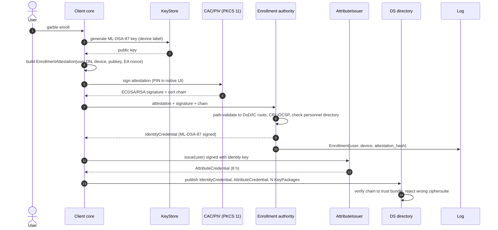

The CAC is touched once. After enrollment, nothing in GARBLE uses it (R§4). A new device repeats the whole flow with its own key.

### 5.2 Create room

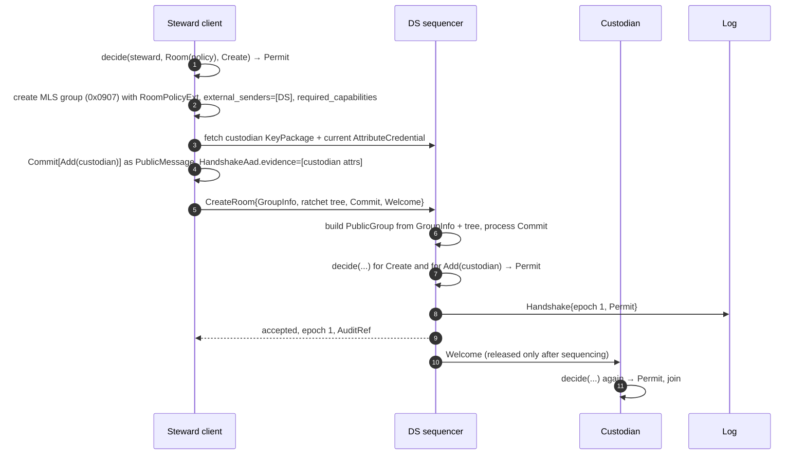

The DS refuses application messages to a room whose tree lacks its custodian. A room isn't live until the custodian is in it.

### 5.3 Add member: three checks, including a denial

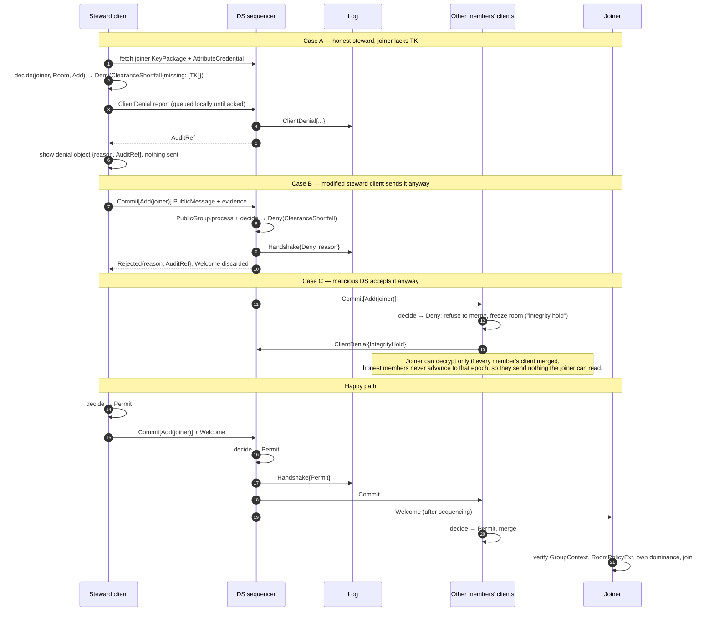

Case C is the thesis. The DS can't create a commit (it isn't a member, and external commits are refused). If it forwards a violating commit, honest clients never enter that epoch, so the joiner's Welcome leads nowhere.

### 5.4 Send message

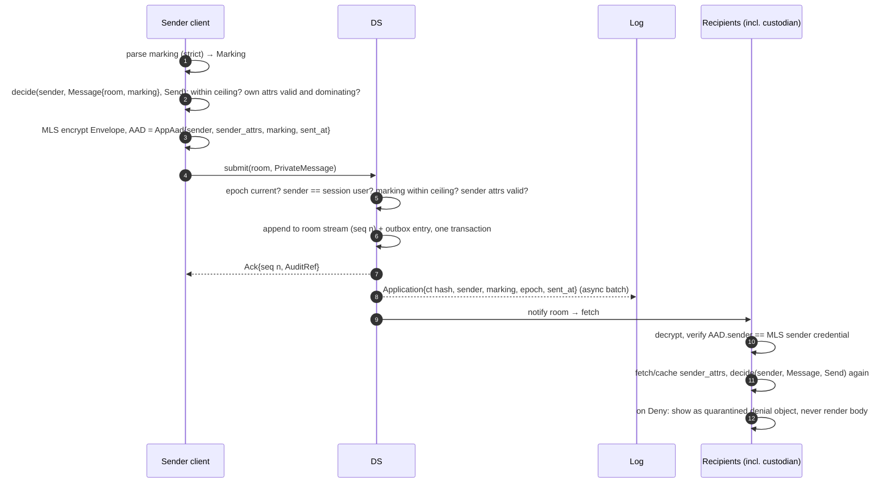

The composer cannot produce an unmarked message. `send` takes a `Marking`, not a string, and the core refuses anything above the ceiling before encryption.

### 5.5 Send file

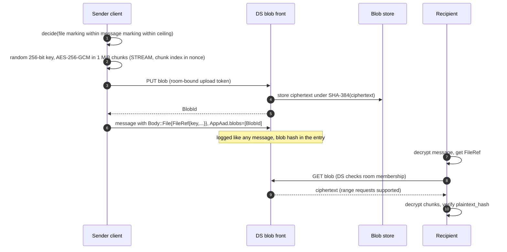

The DS's membership check on download is defense in depth only; confidentiality comes from the key inside MLS. Blobs are content-addressed, so the custodian and the log reference the same hash.

### 5.6 Remove / debrief

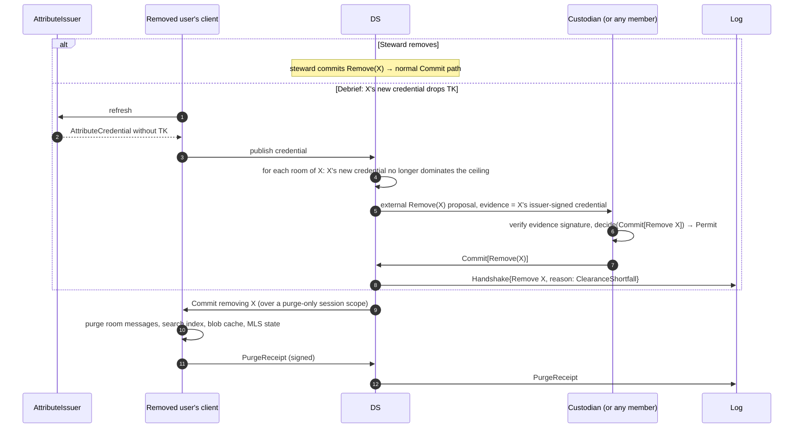

A DS proposal without valid evidence fails `RemoveWithoutEvidence`, so a malicious DS can't evict anyone through auto-commit. Removed or expired users get a **purge-only session**: they can fetch their Remove and post a `PurgeReceipt`, and nothing else. The purge is best effort and documented as such; a receipt proves compliance only for honest clients.

### 5.7 Attribute expiry

Expiry is the revocation mechanism (locked). A credential lasts `lifetime` (default 8 h), and clients refresh it at 50%.

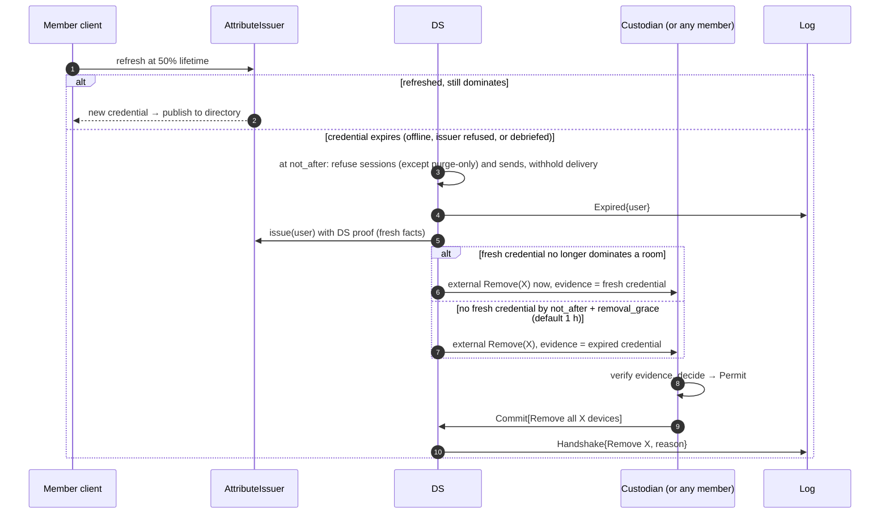

| Between `not_after` and the Remove | Enforced by |
|---|---|
| X cannot send: DS rejects, and every recipient quarantines (`AttributesExpired`) | DS + clients (cryptographic: signed `sent_at` vs credential) |
| X receives nothing | DS only, for at most `removal_grace` |

Cost of the baseline: a user who is offline for longer than `lifetime + removal_grace` (a weekend, for example) is removed from all their rooms and needs a steward to re-add them. §12.1 proposes a mitigation. It is not adopted here, because it would weaken the locked decision.

### 5.8 Discovery card → access request → approval

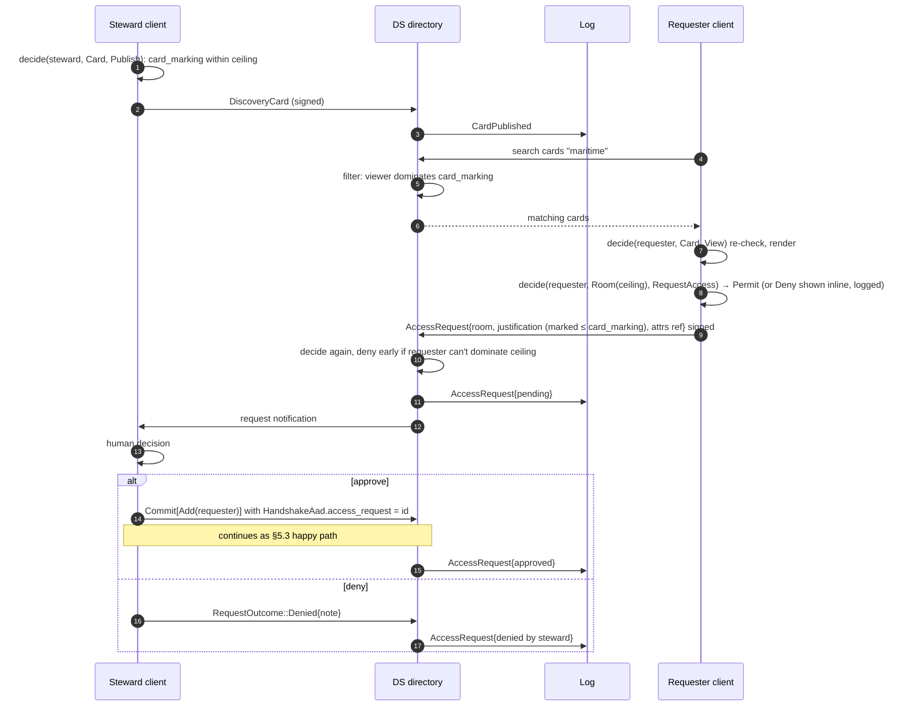

### 5.9 Records custodian archiving

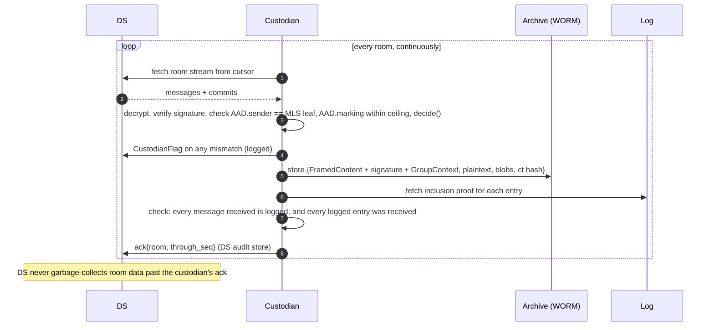

The custodian keeps the **signed** `FramedContent` with its GroupContext, not just plaintext. Years later the signature still verifies against the sender's identity credential, which chains to the CAC attestation. That's the AU-10 evidence chain.

The custodian is also the strongest witness, because it is the only party that sees both the ciphertext stream and the log. A DS that omits a message from the log, or logs one it never delivered, is caught here.

### 5.10 Log checkpoint and witnessing

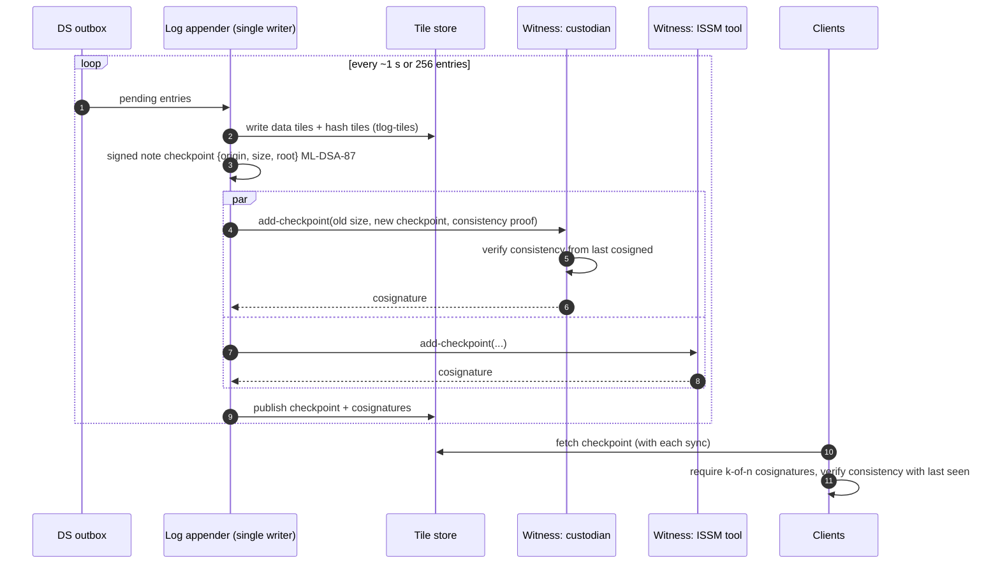

A witness that sees an inconsistent checkpoint refuses to cosign and raises an alarm with both signed checkpoints as proof. Clients keep their last accepted checkpoint and check consistency on every new one (§8).

---

## 6. Server architecture at scale

### 6.1 Logical services

| Service | State | Scales by | Notes |
|---|---|---|---|
| **Gateway** | Stateless (sessions in a shared cache) | Adding nodes behind a load balancer | TLS, session auth, WebSockets, request routing |
| **Sequencer** | Stateful: one owner per room at a time | Sharding rooms by `hash(room_id)` into partitions with leases | Holds `PublicGroup` state, orders commits, runs `decide`, appends to room streams |
| **Directory** | DB rows | DB scaling | KeyPackages, identity and attribute credentials, discovery cards, access requests |
| **Blob front** | Stateless | Nodes | Streams to object storage; membership check on GET |
| **Log appender** | Single writer per log | One log is enough to start; shard only when measured | Batches the outbox into tiles |
| **Notifier** | Stateless | Pub/sub fan-out | Tells gateways "room R has seq n" |
| **Custodian workers** | Per-room cursors + archive | Workers own room partitions, mirroring the sequencer's; all share **one** custodian identity whose key is in an HSM | One logical member, many processes. Each room's MLS state lives with exactly one worker |

### 6.2 Sequencing commits

Each room has exactly one sequencer owner at a time. That owner is a lease on the room's partition held in the database (a row with `owner`, `lease_expires`, `fencing_token`). The owner:

1. Loads `PublicGroup` for the room (LRU cache in memory; loaded from `GroupStore` on miss).
2. For a Commit at epoch *e*: if the room isn't at *e*, reject with `StaleEpoch{current}`. Otherwise run `PublicGroup` processing (signature, tree validity), then one `policy::decide` over the whole commit, then:
3. In **one database transaction**: append the commit to the room stream, persist the new public group state, write the log entry to the outbox, and mark held Welcomes as releasable. The fencing token guards the write so a deposed leader can't commit.
4. Return the ack, notify, and release Welcomes.

First valid commit for an epoch wins. Application messages for the current epoch append without touching `PublicGroup`. A message for epoch *e−1* is accepted within a short window (site parameter), because MLS lets clients decrypt the previous epoch.

### 6.3 Fan-out: on read, not on write

Each message is stored once in a **room stream** (`room_id, seq`), and each device keeps one cursor per room. The notifier publishes `(room, seq)` to gateways, and clients pull. Fan-out on write would copy a message 2,000 times in a 2,000-member room. Only Welcomes and request notifications go to per-user inboxes.

**Read cursors** (which device fetched which room up to which seq) go to the DS audit store (AU-12), for insider-threat review. They're too high-volume for the transparency log.

### 6.4 Storage

| Data | v1 (one box) | At scale |
|---|---|---|
| Room streams, public groups, directory, outbox | SQLite (WAL) | PostgreSQL, partitioned by `hash(room_id)`, read replicas for directory |
| Blobs, tiles | Filesystem | S3-compatible object store (on-prem) |
| Sessions, pub/sub | In process | A cluster cache plus a pub/sub bus |

Retention: the room stream is kept at least until the custodian has acked it, and then for a site-set operational window. The archive, not the DS, is the record.

### 6.5 v1 vs horizontally scaled

v1 is `garble-ds --role all` on one box. At scale it is the same binary run as `--role gateway|sequencer|log-appender`, behind a load balancer. There is one codebase. Scaling means turning on roles and swapping `GroupStore` and `BlobStore` implementations. The protocol and the stored formats don't change.

**Sizing sketch** (unmeasured): 1M users × 100 msgs/day ≈ 1,200 msg/s average, ~12,000 at peak. That is within one batched log writer (CT-log class), and sequencers partition linearly. The real constraint is **post-quantum size**: about 4.7 KB of ML-DSA-87 signature per message and ~9 KB per leaf node.

Mitigations, all in v1:
- The DS serves the ratchet tree, so Welcomes omit it.
- Clients avoid gratuitous path updates.
- `max_members` defaults to 2,000.

---

## 7. Client architecture

### 7.1 Core ↔ Tauri boundary

The Rust core is the application, and the webview is a view. Commands are request/response; events are pushed. Every command returns `Result<T, UiError>`, where a policy refusal is `UiError::Denied(Denial { reason, audit })`, an inspectable object, not a string.

| Commands (webview → core) | Returns |
|---|---|
| `list_rooms()` | `Vec<RoomSummary>` (title, ceiling, unread, last activity) |
| `open_room(room, anchor, limit)` | `Page<MessageView>` |
| `validate_marking(room, text)` | `MarkingCheck { parsed: Option<MarkingView>, decision }`, used live by the composer |
| `send(room, marking, body)` | `MsgId` or `Denied` |
| `attach(room, marking)` | `PendingFile`. The core opens the native file dialog; the webview never supplies a path |
| `banner(visible: Vec<MsgId>)` | `Banner { portion, banner, colors }`, the aggregate high-water mark of what's on screen |
| `search(query, filters)` | `Vec<SearchHit>` |
| `search_cards(query)` / `request_access(room, justification, marking)` | Cards / `RequestId` |
| `add_member(room, user)` / `remove_member(room, user)` | `Ok` or `Denied` |
| `denial(audit_ref)` | `DenialDetail { reason, inputs, log entry, inclusion proof status }` |
| `watermark()` | `WatermarkSpec { text, seed }` |
| `enroll()` / `refresh_attributes()` | Progress events; PIN entry is native |
| `create_room(policy)` / `set_ceiling(room, marking)` / `publish_card(room, card)` | `RoomId` / `Ok` or `Denied` |
| `pending_requests()` / `decide_request(id, approve, note)` | Requests / `Ok` or `Denied` |
| `commands()` | The command registry (ID, title, keybinding, enabled-state) that drives the palette. Every palette action is one of the commands in this table |
| `export(room, range)` | Off by default; a site parameter routes it through a reviewable path (R§2 JSIG) |

| Events (core → webview) | Payload |
|---|---|
| `messages_appended` | room, `Vec<MessageView>` (coalesced, at most every 50 ms) |
| `room_changed` | room, membership or policy diff |
| `denial` | `Denial`, e.g. a quarantined inbound message |
| `credential_state` | `Active` / `Refreshing` / `Expired{since}` |
| `integrity_alert` | Log fork or integrity hold, with evidence |

**Never crosses the boundary:** private keys, MLS state, file keys, the DB key, raw credentials, and any send path without a `Marking`. Markings arrive pre-rendered. The banner is a core call, because aggregation isn't a simple max (REL TO intersects, and NOFORN wins).

Hardening the Tauri side: a capability allowlist containing only the commands above; strict CSP; no remote URLs; no `fs` or `shell` plugins exposed to the webview; and file dialogs opened by the core.

### 7.2 Local storage and encryption at rest

One SQLCipher file per device, keyed by a DB key that `KeyStore` unwraps. It holds OpenMLS storage (through its `StorageProvider` trait), messages, the credential cache, the last checkpoint, and the search index. That gives one encryption-at-rest story (SC-28(1)) and one purge path.

### 7.3 Client-side search

Search uses SQLite **FTS5 in the same encrypted DB**. Results carry their message markings, so a results panel gets its own banner through `banner()`. Room filters, sender filters, date ranges and marking filters are ordinary SQL alongside the FTS match.

Keyword alerting, ChatSurfer's other key feature, is a saved FTS query evaluated when messages are appended. It works only for rooms the user is in and only while the client runs. That is inherent to E2EE, and it's documented as such.

Scale: an ops-center user with 50 rooms and several years of traffic means a few million rows, which is comfortable for FTS5. A dedicated search engine is deferred until measurements show FTS5 falls short.

### 7.4 Multi-room performance

| Concern | Approach |
|---|---|
| One connection for all rooms | One WebSocket per device. Notifications for all rooms multiplex onto it |
| MLS state for 50+ rooms | Load `MlsGroup` lazily; keep open and recently active rooms hot in an LRU |
| Decrypt backlog after a weekend | Background tasks decrypt per room in priority order: visible panels first, then rooms with mentions, then the rest |
| UI flooding | Events are coalesced per room on a 50 ms tick; the webview virtualizes lists |
| Side-by-side panels | Each panel is an `open_room` page plus a subscription; `banner()` is called with the union of visible IDs across panels |
| Credential lookups | Attribute credentials are cached by `CredentialRef`; a message can't be rendered until its sender's credential verifies |

### 7.5 Watermark

The core returns a `WatermarkSpec` (user, device, session seed). The webview tiles it as a low-contrast overlay, so a screenshot or phone photo identifies the viewer. Content is never altered per recipient.

This is client-side and defeatable by a compromised endpoint, which is consistent with the threat model. It deters and attributes; it doesn't prevent.

---

## 8. Failure modes

| Failure | Detection | Behavior (fail closed where it matters) | Recovery |
|---|---|---|---|
| **DS down** | Connection loss | Read local history and search normally. Outgoing messages queue, marked *pending*; nothing is considered sent until acked. No membership changes | Reconnect; resend the queue. Messages encrypted for an epoch that has since moved on are re-encrypted after the client catches up |
| **Commit race** | `StaleEpoch{current}` from the sequencer | Loser fetches and merges the winning commit, re-evaluates its proposals under the new state, and resubmits if still valid | Automatic; at most one retry loop per epoch |
| **Sequencer failover** | Lease expiry | New owner loads state from `GroupStore`; fencing token rejects writes from the deposed owner. A client retry of the same commit is idempotent by commit hash | Automatic |
| **Stale attributes (own)** | Credential past 50% of its lifetime | Refresh. If the issuer is unreachable, keep working until expiry; then no sending and no session (purge-only), and removal after `removal_grace` | Refresh when the issuer is back |
| **Stale attributes (peer)** | `sender_attrs` expired at `sent_at`, or doesn't dominate the marking | Message quarantined: rendered as a denial object, not as content | Sender refreshes and resends |
| **Attribute issuer down** | Refresh failures across users; the DS's own `issue` probe fails | After one credential lifetime, nobody can send or receive (fail closed). The DS **does not** propose expiry-based Removes while its issuer probe fails, because otherwise one outage would empty every room. Removes resume when the issuer is back | Issuer HA; alert at 25% of lifetime |
| **Custodian offline** | Custodian ack lag grows | Messaging continues. The DS keeps everything past the ack, so no record is lost. DS-proposed Removes are committed by any online member (§4.4.2) | Custodian catches up from its cursor. If lag exceeds a site parameter, alert the ISSM. Optionally refuse new messages once storage headroom is low |
| **Log fork detected** | A witness refuses; or a client sees two checkpoints with no valid consistency proof | Witness: alarm with both signed checkpoints. Client: raise `integrity_alert`, stop sending, keep read access to local history. Evidence is self-proving and portable | Out of band: ISSM investigates the DS operator |
| **Integrity hold (DS forwarded a policy-violating commit)** | Client `decide` denies a sequenced commit | Room frozen on that client; `ClientDenial{IntegrityHold}` reported | Steward re-creates the room. The violation is in the log under the committer's and DS's names |
| **Unknown marking / register mismatch** | `MarkingError` or `register_version` mismatch | Deny. A message whose marking won't parse is never rendered | Update the trust bundle |
| **Policy version skew** | Room's `policy_version` > the client's | The client refuses to process the room, rather than guessing | Upgrade the client |

---

## 9. Compliance map

| Control (800-53 r5) | Implemented by | How |
|---|---|---|
| AC-3, AC-3(3) | `policy`; enforced in `client`, `ds` | Mandatory ceiling + dominance; three-way enforcement (§5.3) |
| AC-4 | `policy`, `ds`, `client` | Message marking `within` ceiling, checked on send, at the DS, and on receive |
| AC-16, AC-16(5) | `markings`, `proto`, `garble-desktop` | Signed marking on every message and file; banners and chips |
| SC-16, SC-16(1) | `proto` | Marking carried in MLS-authenticated AAD |
| AC-2 | `ds`, `custodian`, `identity` | Expiry → evidence-backed Remove (§5.7); debrief Remove |
| AC-6 | Architecture | Operators run the DS but are not members; DS can't commit |
| AC-21 | `ds` directory, `policy` | Discovery card → request → steward decision |
| AC-24, AC-25 | `policy` | Distinct, pure, deterministic decision function (claim AC-25 only after review) |
| AU-2, AU-3, AU-12 | `proto::LogEntry`, `ds` | Event list and record contents in §4.7; read cursors |
| AU-6 | `garble-cli` admin commands, ISSM tool | Log query and proof verification |
| AU-9, AU-9(3) | `tlog` | Merkle tree, ML-DSA-87 checkpoints, witness cosignatures |
| AU-10, AU-10(1) | MLS signatures + `custodian` | Signed FramedContent archived; identity chain to CAC attestation |
| AU-11 | `custodian` | Retention via archive; site-set period |
| IA-2(12), IA-5(2) | `identity` (EA) | PIV acceptance and path validation at enrollment |
| IA-2(1)(2) | **Hybrid**: inherited from CAC logon to the endpoint | Daily GARBLE use is single-factor (device key). Don't claim MFA as provided |
| SC-8, SC-8(1) | `client`, `ds` | MLS + TLS |
| SC-12, SC-12(3), SC-13 | `proto::CIPHERSUITE`, provider | CNSA 2.0 suite; `fips` provider for validation |
| SC-17 | `identity` | DoD/IC PKI path validation |
| SC-23 | `ds` gateway | Signed-nonce sessions bound to device key |
| SC-28, SC-28(1) | `client`, `custodian`, `ds` blobs | SQLCipher; file keys; archive encryption |
| SI-7, SI-7(1)(15) | Release process | Signed builds; updater verifies signature |
| SA-24 | Architecture | Fail-closed, witnessed, horizontally recoverable |

### 9.1 How the OSCAL file is generated

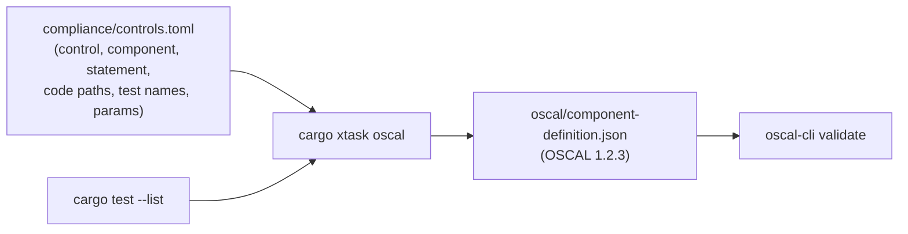

- **`compliance/controls.toml`** is the single human-edited source. Each row gives a control ID (`ac-3.3`), a component (`ds`, `desktop`, `cli`, `custodian`, `log`), an implementation statement, code paths, test names, and `responsibility` (`provided` / `inherited` / `hybrid`). Site-set values go in `set-parameters`.
- **`xtask oscal`** fails the build if a referenced path doesn't exist or a named test isn't in `cargo test --list`. Requirements can't silently rot.
- **Output:** one component per deployable, with a stable UUIDv5 per row (derived from component + control) so diffs are reviewable. `links` point to code at the release tag.
- **CI** validates the output with `oscal-cli` and attaches test results to the release as assessment evidence for cATO.

---

## 10. v1 scope vs later

| Area | v1 | Later |
|---|---|---|
| Clients | CLI/TUI, Tauri desktop | Web (needs a code-integrity story, R§4), mobile |
| Rooms | Collateral + SCI | SAP (JSIG, DoDM 5205.07, separate AO chain); SAP markings already parse |
| Deployment | One box: `--role all`, SQLite, filesystem | Roles split, PostgreSQL, object store, pub/sub |
| Crypto | 0x0907 via libcrux | `fips` provider; IANA code point (§11) |
| Key storage | Encrypted file | HSM (PKCS#11); PQ PIV cards |
| Attributes | `MockIssuer` + `AttributeIssuer` trait | Site issuer fed by personnel-security systems |
| Custodian | One custodian identity, archive to WORM filesystem | Several custodians scoped by compartment (§12.2); TDF export (R§2 IC-ITD) |
| Search | FTS5 local | Larger index engine if measured; no server-side search |
| History for new joiners | None: new members see messages from their join onward | Steward-initiated history sharing |
| Log | One log, custodian + ISSM witnesses | Sharded logs if measured |
| Federation | None. Wire protocol shaped for MIMI (see below) | MIMI hub mapping between deployments on the *same* fabric |
| Records export | Custodian-side, reviewable | ISM/TDF-wrapped exports |

**Shaped for MIMI, not built for it.**
- DS endpoints mirror MIMI's hub operations (`submitMessage`, `groupInfo`, `keyMaterial`, `notify`).
- User IDs are URIs (`garble://<deployment>/u/<id>`), which map to MIMI `mimi://` URIs.
- `RoomPolicyExt` is a self-contained extension that can be translated into MIMI room policy.
- Every API body is versioned `tls_codec`, like MIMI.

---

## 11. Risks and unknowns

### 11.1 OpenMLS API check (8 lookups, 2026-10-04)

| Question | Finding | Confidence |
|---|---|---|
| `PublicGroup` for the DS | Present in **openmls 0.9.0** (crates.io, 25 Aug 2026): `from_external`, `load`, `process_message`, `merge_commit`, `queued_proposals`, `export_ratchet_tree`, `members`, `group_context` | High ([docs.rs](https://docs.rs/openmls/latest/openmls/group/struct.PublicGroup.html)) |
| 0x0907 on crates.io? | **Yes, behind a feature.** `openmls_traits` 0.6.0 has `MLS_256_MLKEM1024_AES256GCM_SHA384_MLDSA87 = 0x0907` under `#[cfg(feature = "draft-ietf-mls-pq-ciphersuites")]`. docs.rs builds without the feature, so it looks absent there. The ML-DSA *signature scheme* code points are provisional too (`MLDSA87 = 0x0906`) | High ([source](https://docs.rs/crate/openmls_traits/0.6.0/source/src/types.rs)) |
| Which provider does ML-DSA-87? | **`openmls_libcrux_crypto` 0.4.0** (25 Aug 2026): `MLDSA44/65/87` and ML-KEM behind the same feature, and it advertises 0x0907 in `supported_ciphersuites` | High on `main` ([crypto.rs](https://github.com/openmls/openmls/blob/main/libcrux_crypto/src/crypto.rs)); the 0.4.0 feature list matches ([crates.io](https://crates.io/crates/openmls_libcrux_crypto)) |
| Custom proposals / extensions | Custom proposal types in 0xF000–0xFFFF are supported, and "policy decisions… have to be made by the application" ([book](https://book.openmls.tech/user_manual/custom_proposals.html)). Custom GroupContext extensions and `external_senders` weren't covered on that page | Proposals high; **GroupContext extension + external sender handling unverified** |
| FIPS provider path | No OpenMLS provider on AWS-LC found. AWS-LC FIPS 3.0 is the first validated module with ML-KEM ([AWS](https://aws.amazon.com/blogs/security/aws-lc-fips-3-0-first-cryptographic-library-to-include-ml-kem-in-fips-140-3-validation)). Whether a validated AWS-LC boundary includes **ML-DSA-87** wasn't confirmed | Medium |

**Consequences for the design:**
- Pin `openmls = "0.9"` and `openmls_libcrux_crypto = "0.4"` with `features = ["draft-ietf-mls-pq-ciphersuites"]`; there's no need to track `main`.
- The `fips` feature means GARBLE writes its own small `OpenMlsCrypto` provider over aws-lc-rs, as a v1.x task.
- **Spike first, before any other code:** a 2-member group on 0x0907 whose `PublicGroup` (a) reads a private-use GroupContext extension, (b) accepts an `external_senders` Remove proposal, and (c) carries the custom `GarbleCredential` type in its leaves. Fallbacks if any of these fail: (a) the policy moves into app data, (b) the custodian proposes Removes as a member, (c) a basic credential whose identity is the encoded `IdentityCredential`.

| Risk | Impact | Mitigation |
|---|---|---|
| **0x0907 is provisional.** IANA may assign a different code point | MLS doesn't allow a group to change ciphersuite. A renumber would mean an MLS ReInit of every room | Treat 0x0907 as a permanent alias in our closed deployment; new rooms use the IANA value once assigned; ReInit only when federating |
| **libcrux maturity.** Pre-0.1; ML-DSA FIPS 204 issues fixed March 2026 (R§3) | Correctness bugs in signing | Pin versions; run the NIST ACVP vectors in CI; `fips` provider as the production path |
| **No validated CNSA 2.0 module confirmed.** Whether a FIPS 140-3 module covers ML-KEM-1024 and ML-DSA-87 today is unverified | "Compliant" requires validated modules (CNSSP 15, deadline 1 Jan 2027) | `fips` feature behind the provider trait; track CMVP |
| **PQ object sizes.** ~4.7 KB signature per message; ~9 KB leaf; large commits are MB-scale | Bandwidth and storage at IC scale | DS serves the tree; `max_members`; measure early with the CLI load generator |
| **Signed-note has no ML-DSA-87 signature type** in C2SP | Off-the-shelf witnesses (Ed25519 cosignature/v1) can't be used | Define a GARBLE key-type byte; witnesses are ours anyway on an air-gapped fabric. Revisit when C2SP adds one |
| **Issuer availability is a hard dependency** | Issuer outage = deployment-wide send/receive stop after one credential lifetime | HA issuer; alerting; lifetime is a site parameter |
| **Custodian is the crown jewel** | It holds everything in its scope | HSM keys; two-person archive export; scoped custodians (§12.2) |
| **Card aggregation.** Compartment names or titles may be classified above the card marking | Card leaks | Steward attestation; registers carry each compartment name's own marking for `policy` to check |
| **Webview attack surface.** Plaintext is rendered in WebKit/WebView2 | A rendering bug leaks plaintext to a local attacker | Strict CSP, no remote content, text-only rendering in v1 (no HTML, no inline previews) |
| **Log hash is SHA-256.** RFC 6962 and tlog-tiles fix SHA-256; CNSA 2.0 lists SHA-384/512 | An assessor may flag the log as non-CNSA | See §12 item 5. SHA-256 collision resistance has no known practical quantum attack, but it's below CNSA 2.0's SHA-384 |
| **Clock skew.** Expiry and `sent_at` checks depend on clocks | False denials or a stretched validity window | Fabric NTP; DS rejects `sent_at` more than 2 minutes from its own clock; clients compare `sent_at` against the DS sequence time |

---

## 12. Challenges to the locked decisions

None of these are adopted in the design above. Each needs a decision.

**1. Expiry-only revocation removes people for being offline.** Under §5.7, anyone offline for longer than `lifetime + removal_grace` (9 h by default, so every weekend) is removed from every room and must be re-added by a steward. At IC scale that's millions of commits a week. *Proposal:* when the DS's pull from the issuer shows the absent user *still* dominates, withhold delivery but don't Remove until a `max_absence` (for example 7 days); remove immediately when they no longer dominate. The cost is that during that window, keeping content from them relies on the DS, not on cryptography. Optionally, an issuer-signed "attributes changed" ping could trigger an immediate pull, which is closer to ICD 503's push requirement. It isn't a revocation list.

**2. One custodian in every room means one identity that dominates every compartment on the fabric.** Some compartment owners won't accept that, and it concentrates risk. *Proposal:* keep "a custodian is a visible member of every group", but allow several custodian identities, each scoped to a set of compartments, with the trust bundle mapping ceilings to custodians. v1 as designed ships one.

**3. The provisional code point and the "one constant" claim.** Changing the constant is one line. Migrating existing groups means a ReInit of every room, because MLS can't change a group's ciphersuite. The ML-DSA signature-scheme code point is provisional too. *Proposal:* treat 0x0907 as permanent inside a deployment, accept the IANA value as well for new rooms, and ReInit only when federating.

**4. "The DS holds Welcomes until the Commit is sequenced" is necessary but not the control.** A malicious DS can sequence a bad commit and release its Welcome (§5.3 case C). What stops the joiner from reading anything is honest clients refusing the epoch. Keep the decision, but don't cite it as the enforcement in the OSCAL statements.

**5. RFC 6962 + tlog-tiles hashing is SHA-256, not a CNSA 2.0 hash,** and signed-note has no standard ML-DSA-87 key type. Options: (a) keep SHA-256 for format compatibility and define a GARBLE signed-note key type; (b) fork the formats to SHA-384 and lose every off-the-shelf verifier. *Recommendation:* (a), raised with the AO early rather than found at assessment.
